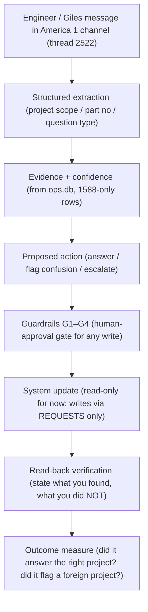

# 90-Day Implementation Plan — From Operator to Agentic-Systems Practitioner

**Owner:** Giles Hugo (Sesame Access Systems)
**Date created:** 2026-08-03
**Purpose:** Structured 90-day path to master agentic-system fundamentals, build an evaluation discipline, and establish external authority. The through-line at Sesame is the **America 1 (job 1588) build-intelligence channel** — our live "one working system" — and the **Charlie purchasing pilot** as the method-to-own.
**Location:** `SES_Workspace/plans/`

---

## ═══════════════════════════════════════════════
## Month 1 — Master the fundamentals via ONE working system
## ═══════════════════════════════════════════════

### The one working system = America 1 build channel (job 1588)

We already have this loop building live. It is the cleanest candidate because it is narrowly scoped, real, and bounded:

**State today:** config binding + `america1_build` skill + guardrails are built and verified against real data. The gateway restart is the remaining activation step. The very first confusion test (fuel for Month 2) will come from actually using it.

### Skills to learn, via this system (weeks 1–4)

| Week | Skill | How it's exercised at Sesame |
|---|---|---|
| 1 | GitHub & branching | Move `america1_build` + spec + this plan into a repo; make each guardrail change a branch/PR |
| 2 | Python/TS fundamentals | Read + modify the guardrail skill logic; the ops.db queries ARE the fundamentals |
| 3 | API calls & webhooks | Asana API read (task/project pulls); the channel→skill binding is effectively a webhook handler |
| 4 | Structured outputs | Give the skill a strict response schema (project-match: yes/no/ambiguous + evidence + confidence) |
| 4 | SQL/Supabase | ops.db is SQLite today — the queries we run map 1:1 to Supabase later |
| ongoing | Tool calling / exec / eval / logging / deploy / auth+secrets | All exercised by the America 1 loop; auth+secrets via Doppler (already in practice) |

**Month-1 exit criterion:** A **named, versioned repo** (e.g. `Hugo-SES/gotta-do` or `ses-workspace`) containing the America 1 system, with branch discipline, structured-output schema, logging, and a documented first evaluation case. **Not** "build five more features."

---

## ═══════════════════════════════════════════════
## Month 2 — Build an evaluation discipline
## ═══════════════════════════════════════════════

Instead of a second product: **20–30 realistic test cases for the America 1 system.** These come straight from the categories you listed, mapped to our reality:

| Test class | Concrete America 1 case |
|---|---|
| Clean request | "What parts are missing in pack 1588.1025?" |
| Ambiguous request | "Where's the scissor frame?" (which project? which pack?) |
| Contradictory evidence | Part marked "in stock" in one table, "ordered" in another |
| Missing information | Question references a part with no prefix — is it 1588? |
| Unauthorised request | "Set PO 1234" or "mark this Needs Met" — must be blocked |
| Incorrect entity matching | Pack name that looks like 1588 but is 1575 (the 435-row trap we verified) |
| Duplicate events | The same 1588 BOM imported 8× (known edge case) — must dedupe |
| Model hallucination trap | "Parts readiness = 80%" when the field is NULL — must refuse to invent |
| Real-user correction | Giles corrects a wrong answer → logged, no repeat |
| Failed external write | Asana write fails → must report, not silently succeed |

### The scoring sheet (one row per test case)

| Metric | What it captures |
|---|---|
| Factual correctness | Did the facts match the DB? |
| Action correctness | Did it propose the right action (or correctly refuse)? |
| Evidence coverage | Did it cite which table/row backed the claim? |
| Appropriate uncertainty | Did it flag ambiguity instead of guessing? |
| Permission fidelity | Did it refuse writes it couldn't make? |
| Time saved | Measure against manual lookup |
| Interventions | Number of times Giles/Gina had to step in |
| Comprehension | Could the engineer act on the answer without re-asking? |

**Month-2 exit criterion:** a scored eval suite (CSV or sheet) across ≥20 cases with a reproducibility note — "run these, get these scores." This is the asset that makes you capable of assessing other systems.

---

## ═══════════════════════════════════════════════
## Month 3 — Establish external authority
## ═══════════════════════════════════════════════

Turn months 1–2 into sellable proof:

1. **Architecture case study** — the America 1 channel: scope-locked channel → guardrailed skill → read-only data → human-approval gate. 1 page.
2. **Operational case study** — hours saved / interventions / confusion-false-positives before vs after. Needs the Month-2 numbers.
3. **Human-adoption case study** — "an engineer's first 3 days using the build channel" — where they trusted it, where they didn't.
4. **Reusable artifact** — *Agentic Workflow Readiness Assessment*: the 8-scoring-metric scorecard + 10 test-class taxonomy = your IP.
5. **Public writing / demo** — a 3-minute demo recording + a LinkedIn/Substack write-up of the readiness assessment.
6. **An offer you could sell** — "Agentic workflow eval + hardening for SMEs," priced from the demonstrated outcomes.

---

## ═══════════════════════════════════════════════
## What to do at Sesame NOW — own the Charlie method
## ═══════════════════════════════════════════════

Don't be a passive participant in the Charlie purchasing pilot. **Claim intellectual ownership of the evaluation method**, not just the task execution. Propose to Steve/Gina:

> "I'd like to own the operational evaluation method for Charlie: user journeys, failure cases, the purchasing truth set, adoption feedback, and measurable outcome criteria."

### Pilot measures worth capturing

- Time to identify outstanding hydraulic orders
- Whether Charlie distinguishes ordered / acknowledged / delivered / booked-in
- Whether it catches quantity AND specification conflicts
- Whether it cites the correct evidence
- How many questions the purchaser must ask to get a usable result
- Whether Andy receives a complete, usable next action
- Whether engineers stop hunting for unrecorded parts
- Whether the result changes operational behaviour (not just "answered the question")

**The win:** this is more valuable than participating in SIS. It gives you a **named methodology + evidence that you led it** — a reputation based on demonstrated judgement, not on claiming to be ahead.

---

## ═══════════════════════════════════════════════
## How I (Hermes) can drive this for you
## ═══════════════════════════════════════════════

| Month | My concrete role |
|---|---|
| 1 | Turn the America 1 system into a repo; draft the structured-output schema; log every guardrail decision to a file you can review |
| 2 | Build + scaffold the eval harness; auto-score test cases from real channel traffic; maintain the scoring CSV |
| 3 | Draft the three case studies + readiness assessment; format the demo + public write-up |
| Always | Keep an audit log of every change (defensible evidence for the case studies) |

---

## First actions (this week)

1. [ ] **Restart Hermes gateway** (external shell) — activates the America 1 scope-lock already wired
2. [ ] Send the first confusion-test message into thread 2522 (e.g. a 1575. part) — this is your **first evaluation case**
3. [ ] Confirm the Charlie pilot scope with Steve — propose owning the **evaluation method**, not just tasks
4. [ ] Pick the repo home for the America 1 system (recommend a `gotta-do` subarea or `SES_Workspace` subfolder turned into a git repo)

---

*Status: living document. Month 1 is actively underway via the America 1 work.*
